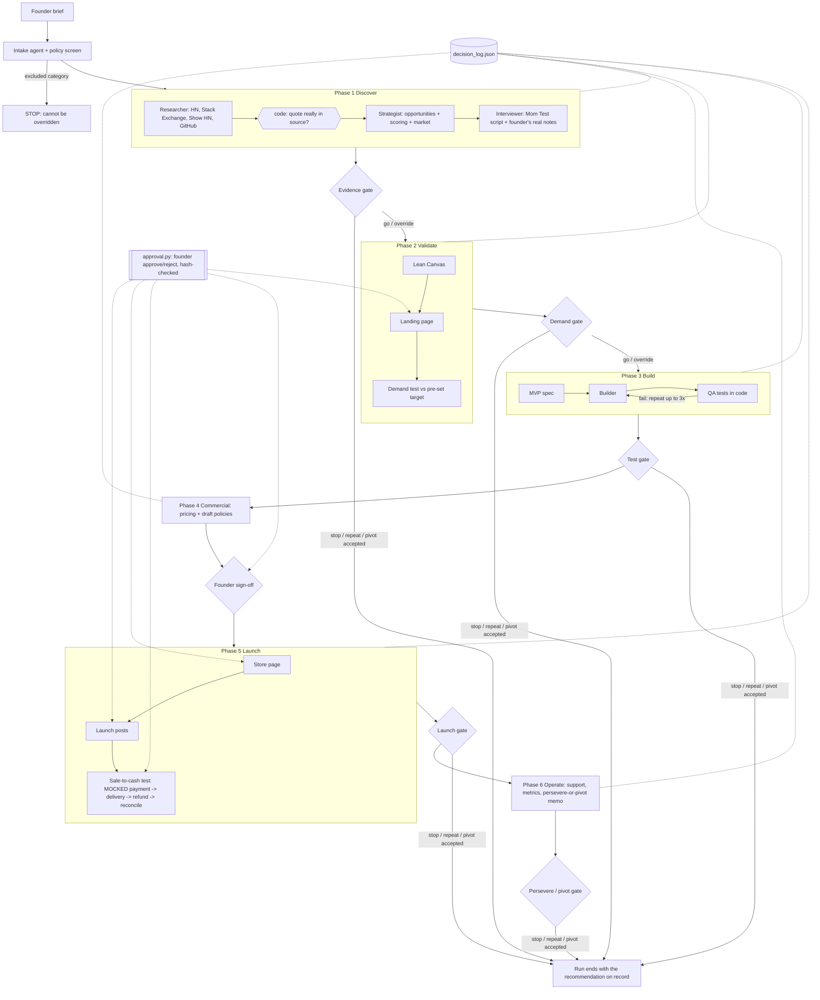

# Architecture

## Overview

Open Venture Builder is a pipeline of small, single-purpose agents run by one orchestrator (`orchestrator.py`). A founder brief goes in; the system works through six phases, and **every phase ends with a gate** that recommends **go, repeat, pivot or stop** from thresholds fixed before any evidence is collected. The founder accepts the recommendation or overrides it, and the override is recorded. Anything that would be published, sent, spent or signed needs a founder approval that is checked in code (`approval.py`) against a hash of the exact content. All model calls go to an open-weight model through an OpenAI-compatible API: local Ollama (`qwen3:4b`) by default, or GPT-OSS 120B on a free tier for speed (tested; rate limits handled with retries). Every agent action is appended to `decision_log.json`. Deterministic code, not the model, does the parts that must be trusted: quote verification, scoring arithmetic, gate decisions, product tests, guardrails, payment idempotency and reconciliation.



## Phases

### Phase 1: Discover (core step: find opportunities)

- **Agents:** Intake (`agents/intake.py`), Researcher (`agents/researcher.py`), Strategist (`agents/strategist.py`), Interviewer (`agents/interviewer.py`).
- **Tools:** Hacker News Algolia API (posts and comments), Stack Exchange API (softwarerecs, webapps, freelancing, workplace, ...), Show HN launches and GitHub search for existing products (`tools/research.py`). All free, no keys. Results are cached for 7 days.
- **Method:**
  1. Intake parses the brief (regex first, model only for free-form briefs) and runs the policy screen. Excluded categories stop the run and cannot be overridden.
  2. Thresholds are written into `phase1_step0_intake.md` before research starts (pre-registration).
  3. The Researcher writes search queries in the customer's words, fetches real posts, and asks the model for an exact quote from each post that shows the problem. **Code then checks that the quote appears in the fetched text**; unmatched quotes are dropped and logged (`drop_unverified_quote`).
  4. The Strategist sharpens the founder's idea and proposes two alternatives. The score is computed in code: evidence = 40 pts (verified signals, capped at 8) plus founder fit, feasibility within budget/time, differentiation and values fit at 15 pts each (model ratings 1-5 with written reasons, labelled ASSUMPTION).
  5. Market definition: ICP, segments, competitors (only from fetched products), market claims. A claim without a valid source id is rendered as **ASSUMPTION**. Market size is never invented.
  6. Mom Test interview script. If the founder supplies real interview notes, each is analysed (past behaviour and commitments count, compliments do not); quotes must appear in the notes. The system never simulates interviews.
- **Output:** `phase1_step0_intake.md`, `phase1_step1_opportunities.md`, `phase1_step2_scoring.md`, `phase1_step3_market.md`, `phase1_step4_interviews.md`, `phase1_gate_decision.md`.

### Phase 2: Validate (core step: design the business)

- **Agent:** Validator (`agents/validator.py`).
- **Method:** Lean Canvas with per-item citations; honest waitlist landing page (says the product is not built, no testimonials, counters or urgency) rendered from `templates/landing.html`; demand-test plan with non-spam channels. Publishing the page needs founder approval and is MOCKED (local outbox). The local app serves the page at `/lp/<run_id>` with a consent-based waitlist that stores only email hashes. The gate reads **real** numbers supplied by the founder (`--metrics`) or the local waitlist; with no data it recommends REPEAT and never simulates sign-ups.
- **Output:** `phase2_step1_lean_canvas.md`, `phase2_step2_landing_page.html`, `phase2_step3_demand_test.md`, `phase2_gate_demand.md`.

### Phase 3: Build (core step: build the product)

- **Agents:** Builder (`agents/builder.py`), QA (`agents/qa.py`, no model).
- **Method:** MVP spec with sections and an acceptance phrase per section, then the product itself: a Markdown toolkit (guide, checklists, fill-in templates) that a small local model can write reliably and a buyer can use the same day, plus user docs. QA runs deterministic tests: length bounds, required phrase per section, no unsourced statistics, no placeholders, no guardrail violations, docs contain quick start / help / refunds. Failing sections are rebuilt with the failure as feedback (gate outcome REPEAT, up to 3 attempts), then STOP if still failing.
- **Output:** `phase3_step1_mvp_spec.md`, `phase3_step2_product.md`, `phase3_step3_user_docs.md`, `phase3_step4_qa_report.md`, `phase3_gate_tests.md`.

### Phase 4: Commercial setup (core step: set the price and policies)

- **Agents:** Pricing (`agents/pricing.py`), Legal drafting (`agents/legal.py`, templates only, no model).
- **Method:** one-time price with rationale (alternatives cited by source id, everything else ASSUMPTION), free preview, honest price test, refund window; code rejects invalid or extreme prices. Terms, privacy and refund policies are filled from open templates and labelled DRAFT / not legal advice. **No payment of any kind is set up.** Gate: founder sign-off.
- **Output:** `phase4_step1_pricing.md`, `phase4_step2_policies.md`, `phase4_gate_signoff.md`.

### Phase 5: Launch (core step: open the store, deliver automatically)

- **Agent:** Launcher (`agents/launcher.py`); sale-to-cash modules `payments.py`, `checkout.py`, `webhooks.py`, `delivery.py`, `refunds.py`, `reconcile.py`.
- **Method:** store page from `templates/store.html` (checkout disabled, MOCKED label), three launch posts in the founder's voice, **each approved or rejected individually**; approved ones go to the local outbox (MOCKED). Then an end-to-end sale-to-cash test against the mock provider (see below). Gate: all payment tests pass; then the founder approves opening the (MOCKED) store with automatic delivery.
- **Output:** `phase5_step1_store_page.html`, `phase5_step2_launch_posts.md`, `phase5_step3_delivery_test.md`, `payment_test_log.md`, `phase5_gate_launch.md`.

### Phase 6: Operate and learn

- **Agent:** Operator (`agents/operator.py`).
- **Method:** FAQ and support reply templates (drafts the founder sends), a metrics table that keeps real numbers and MOCKED test orders apart, and a persevere-or-pivot memo whose recommendation must match the gate. Gate: persevere needs at least 10 real paying customers with low refunds; with zero real sales the gate says REPEAT (go get real evidence) rather than persevere.
- **Output:** `phase6_step1_support.md`, `phase6_step2_metrics.md`, `phase6_step3_persevere_pivot_memo.md`, `phase6_gate_next.md`.

## Gates

| Gate | Checks (thresholds in `config/gates.json`, fixed before evidence) | Outcomes |
|---|---|---|
| Policy (P1) | Excluded categories: physical goods, financial/crypto, health or legal advice | go / **stop (no override)** |
| Evidence (P1) | Verified pain signals >= 5, opportunity score >= 60, interviews >= 5 with >= 60% describing the problem | go / repeat / pivot / stop |
| Demand (P2) | Real sign-ups vs pre-set target (100 in 14 days), visitors >= 200 for a readable signal | go / repeat / pivot / stop |
| Tests (P3) | All QA tests pass | go / repeat (rebuild) / stop after 3 attempts |
| Sign-off (P4) | Valid price, no pricing issues, founder signs price and policies | go / repeat |
| Launch (P5) | Paid order delivers, duplicate webhook ignored, forged webhook rejected, refund revokes access, reconciliation balances | go / stop |
| Next (P6) | >= 10 real paying customers, refunds <= 20% | persevere (go) / repeat / pivot |

### Every step ends with a check

Each step ends with one of the three gate types: a **test** run by code, a **threshold** fixed in advance, or a **founder approval**. Phase gates (table above) combine them and ask the founder to accept or override.

| Step | Gate type | What is checked (in code) |
|---|---|---|
| P1.0 Intake | test | Excluded-category screen; a hit stops the run and cannot be overridden |
| P1.1 Find opportunities | test | Each quote must appear word for word in its fetched source and mention the founder's problem terms; others are dropped and logged |
| P1.2 Score vs alternatives | threshold | Score computed by code; below 45 → STOP, below 60 → REPEAT; an alternative 10+ points higher → PIVOT |
| P1.3 Define market | test | Claims without a valid source id are printed as ASSUMPTION; market size is never invented |
| P1.4 Interviews (Mom Test) | threshold | At least 5 real interviews, 60% describing the problem from past behaviour; none supplied → counted as missing, never simulated |
| P2.1 Lean Canvas | test | Each item cites a source id or is labelled ASSUMPTION |
| P2.2 Landing page | test + approval | Output scanner removes promises, fake proof and urgency; publishing needs a founder approval bound to the exact HTML |
| P2.3 Demand test | threshold | Real sign-ups vs the pre-set target (100 in 14 days); 12 of 100 → STOP; no data → REPEAT |
| P3.1 MVP spec | test | Product name may not match an existing product found in research (renamed if it does) |
| P3.2 Build product | test | QA: length, required phrase per section, no unsourced statistics, no placeholders, no rule-breaking text; failing sections rebuilt (max 3 attempts) |
| P3.3 User docs | test | Docs must contain quick start, how to get help and refunds |
| P4.1 Pricing | test + approval | Price must be a valid number within bounds (code check); founder signs off |
| P4.2 Policies | approval | Terms, privacy and refund drafts (labelled not legal advice) need founder sign-off |
| P5.1 Store page | test + approval | Output scanner; opening the (MOCKED) store needs founder approval |
| P5.2 Launch posts | approval | Each post approved or rejected individually; rejected posts are never published |
| P5.3 Sale to cash | test + approval | Paid order delivers, duplicate and forged webhooks ignored, refund (founder-approved) revokes access, books reconcile |
| P6.1 Support | test | Output scanner; replies are drafts only, nothing is sent |
| P6.2 Metrics | test | MOCKED test orders are excluded from every decision |
| P6.3 Persevere-or-pivot memo | threshold | At least 10 real paying customers to persevere; the memo is written from the gate result |

**When the system recommends STOP:**
- Fewer than 2 verified pain signals, or an opportunity score below 45.
- Real interviews contradict the desk research (less than 30% have the problem).
- Demand test below 25% of the target (for example 12 of 100 sign-ups: STOP, not "promising early traction").
- The MVP still fails its own tests after 3 build attempts.
- Sale-to-cash tests fail (buyers could pay without receiving the product).
- The idea is in an excluded category.

PIVOT is recommended when an alternative scores at least 10 points higher, or demand lands between 25% and 50% of target. REPEAT is recommended when evidence exists but is below threshold, or when there is no real data yet. The founder can override repeat/pivot/stop to keep going (except the policy stop); the original recommendation stays in the gate file and the log.

## Sale to cash

All of this runs against `MockPaymentProvider` (**MOCKED**: no real or sandbox payment service; test buyers only).

1. **Payment triggers delivery.** The provider sends a signed `payment.succeeded` webhook. `webhooks.py` verifies the HMAC signature, records the payment, marks the order paid and calls `delivery.deliver`, which creates one access token and writes the delivery email to the log (MOCKED email).
2. **Idempotency prevents double delivery.** Every event id is stored with a primary key, so a repeated webhook is ignored. Payments are unique per order, and access grants are unique per order, so even a second, different payment event for the same order cannot deliver twice. Forged webhooks (bad signature) are rejected.
3. **A refund revokes access.** Refunds need founder approval (hash-checked); the provider (never this system) executes it and sends `refund.succeeded`; `refunds.py` records it and deactivates the download token.
4. **Reconciliation matches orders, payments, fees and payouts.** `reconcile.py` checks that every paid order has a payment of the right amount and a delivery, nothing was delivered unpaid, refunded orders have no live access, and payouts = gross - fees - refunds.

The result of each step is in `outputs/payment_test_log.md`.

## Data flow

```
brief.md ──> Intake ──> RunContext.state["brief"] ──────────────────────────────┐
                │                                                              │
public APIs ──> Researcher ──> SourceRegistry (S1..Sn, real URLs) ──> verified signals
                                                     │                         │
                                Strategist (scores in code) ──> opportunity, market
                                                     │
founder interview notes ──> Interviewer ──> interview evidence ──> Evidence gate
founder metrics.json / local waitlist ──────────────────────────> Demand gate
opportunity + canvas ──> Builder ──> product.md ──> QA (code) ──> Test gate
spec ──> Pricing + Legal templates ──> founder sign-off
spec + pricing ──> Launcher ──> drafts ──> approval.py ──> outbox/ (MOCKED)
MockPaymentProvider ──> webhooks ──> delivery / refunds ──> ledger.sqlite ──> reconcile
every step ──> decision_log.json   every phase ──> outputs/phaseN_*.md
```

Model access is only through `llm.py`; research only through `tools/research.py`; outbound actions only through `outbox.py` and the payment mock, both of which call `require_approved` first.

## Built vs. stubbed

| Component | Status |
|---|---|
| Orchestrator, agents, gates, thresholds, decision log | Built |
| Research on real public sources with quote verification | Built |
| Guardrails (brief screen, request screen, output scanner) | Built |
| Founder approval (CLI, web UI, decisions file), hash-checked | Built |
| Web UI with live run view and approve/reject buttons | Built |
| Model access: local Ollama or free-tier open-weight model (GPT-OSS 120B), with retry on rate limits | Built |
| Product generation (Markdown toolkit) and QA tests | Built |
| Customer interviews | Founder-supplied only; never simulated |
| Publishing pages/posts, opening the store | **MOCKED** (local outbox) |
| Payment provider, checkout, payouts | **MOCKED** |
| Delivery emails | **MOCKED** (logged, not sent) |
| Real traffic and analytics for the demand test | **STUBBED**: founder supplies real numbers via `--metrics` |
| Other product formats (web apps, courses) | Not built (roadmap) |

## Roadmap

1. Connectors that publish through the founder's own accounts after approval (static hosting for the landing page, Buttondown/Listmonk for the waitlist), still behind `approval.py`.
2. A real payment-provider adapter in test mode, behind the same webhook/idempotency/reconcile code, when hackathon rules no longer forbid it.
3. More evidence sources (Reddit, app-store reviews, public forums) with the same quote verification.
4. More product formats: small single-page web tools with generated tests, short email courses.
5. Re-running a phase with new evidence (resume from a gate instead of starting over).
6. Evals: a larger trick-prompt suite and scored briefs to track gate accuracy over time.
